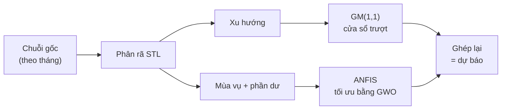
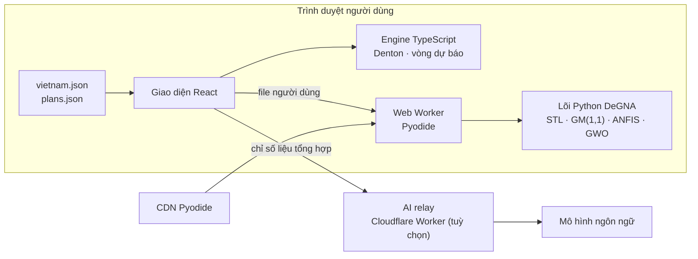
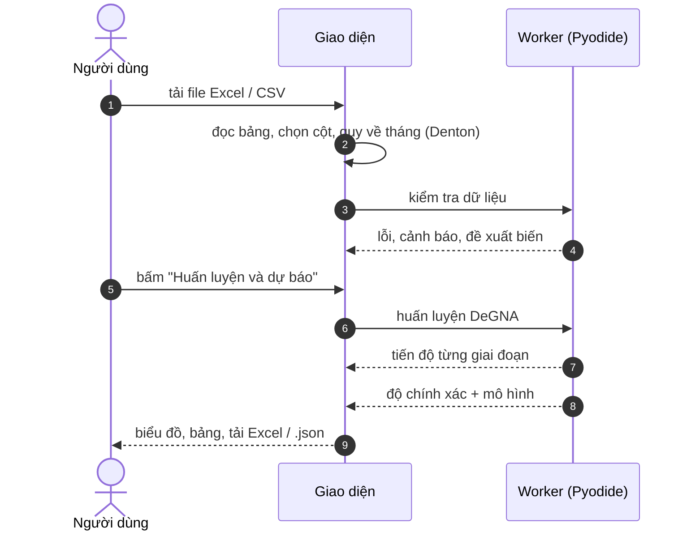

<div align="center">


# Foresight Lab

**Hệ thống mô phỏng và dự báo nhu cầu năng lượng sơ cấp Việt Nam theo kịch bản, dựa trên mô hình lai Grey – Neuro-fuzzy DeGNA**

[](https://doi.org/10.32604/cmes.2026.086196)


[Giới thiệu](#giới-thiệu) ·
[Demo](#demo) ·
[Mô hình DeGNA](#mô-hình-degna) ·
[Kiến trúc](#kiến-trúc) ·
[Bắt đầu nhanh](#bắt-đầu-nhanh) ·
[Cấu hình](#cấu-hình) ·
[Trích dẫn](#trích-dẫn)

</div>

---

## Giới thiệu

Quy hoạch năng lượng cần trả lời những câu hỏi cụ thể. Nhu cầu năm 2030 sẽ là bao nhiêu nếu sản xuất công nghiệp tăng
nhanh hơn dự kiến? Nguồn cung trong quy hoạch có đủ không? Thông thường, mỗi câu hỏi như vậy phải nhờ chuyên gia chạy
lại mô hình.

Foresight Lab đưa mô hình **DeGNA**, đã công bố trên tạp chí *Computer Modeling in Engineering & Sciences* (CMES, 2026),
vào một ứng dụng web mà ai cũng dùng được. Toàn bộ phép tính chạy **ngay trong trình duyệt**: không có server, không gửi
dữ liệu đi đâu.

Ứng dụng có hai không gian:

1. **Năng lượng Việt Nam:** mô hình đã huấn luyện sẵn trên số liệu Việt Nam. Người dùng kéo thanh trượt tốc độ tăng IIP
   và FDI để xem nhu cầu năng lượng thay đổi ra sao, rồi so với mục tiêu cung trong các quyết định quy hoạch.
2. **Công cụ dự báo:** người dùng tải chuỗi thời gian của mình (Excel hoặc CSV). Hệ thống kiểm tra dữ liệu, đề xuất biến,
   huấn luyện DeGNA bằng Python chạy trong trình duyệt và trả về dự báo từ 3 đến 72 tháng.

### Ai dùng và dùng để làm gì

| Người dùng | Dùng Foresight Lab để |
| --- | --- |
| Quản lý nhà nước | So nhu cầu dự báo với mục tiêu cung trong quy hoạch, thử các kịch bản tăng trưởng |
| Nhà đầu tư | Ước lượng quy mô nhu cầu năng lượng đến 2030 và xa hơn theo từng kịch bản |
| Doanh nghiệp | Đặt mốc cung riêng (kế hoạch doanh nghiệp, quy hoạch tỉnh) để cân đối với nhu cầu |
| Nhà nghiên cứu, sinh viên | Huấn luyện DeGNA trên chuỗi dữ liệu của mình mà không cần cài đặt gì |

Khi mở lần đầu, ứng dụng hỏi vai trò của người dùng để ưu tiên các thông tin phù hợp.

### Tính năng nổi bật

**Năng lượng Việt Nam**
- Ba kịch bản Thấp, Cơ sở, Cao hoặc tự chọn tốc độ tăng IIP và FDI cho giai đoạn 2025–2030. Biểu đồ, bảng và thẻ
  "Điều cần biết" cập nhật ngay.
- Xem theo năm, phần tăng thêm mỗi năm, theo tháng và theo quý. Có thể kéo tầm dự báo vượt mốc 2030, kèm cảnh báo về độ
  tin cậy.
- Cân đối cung – cầu năm 2030 với QĐ 893/QĐ-TTg và Quy hoạch điện VIII điều chỉnh. Có thể nhập mốc cung riêng.
- Phân tích tác động: mỗi thay đổi của IIP và FDI làm nhu cầu thay đổi bao nhiêu.
- Tải bảng dự báo ra Excel.

**Công cụ dự báo**
- Quy trình 5 bước: Dữ liệu → Chọn cột → Kiểm tra → Huấn luyện → Kết quả.
- Tự kiểm tra dữ liệu (độ dài, giá trị thiếu, kỳ trùng, kỳ bị hở, cột không đổi) và đề xuất giữ biến ngoại sinh nào
  dựa trên tương quan.
- Dữ liệu theo năm hoặc quý được chia thành chuỗi tháng bằng phương pháp Denton – Cholette theo một chỉ báo tháng.
- Hiển thị tiến độ huấn luyện từng giai đoạn: STL, GM(1,1), ANFIS, tối ưu bầy sói xám, chọn cửa sổ dài hạn.
- Độ chính xác trên tập kiểm tra. Dự báo kèm hai cách ngoại suy xu hướng để so sánh.
- Xuất kết quả kiểm tra, dự báo ra Excel và lưu mô hình dạng `.json`.

**Trợ lý giải thích (tuỳ chọn)**
- Trả lời câu hỏi về kết quả đang xem, chỉ dùng số liệu tổng hợp mà trang gửi lên.
- Câu trả lời nào có con số không nằm trong số liệu đó sẽ bị ẩn.
- Không cấu hình trợ lý thì phần giải thích vẫn chạy bằng câu tự sinh từ số liệu.

## Demo

<div align="center">


</div>

## Mô hình DeGNA

**DeGNA** (Decomposition-based Grey – Neuro-fuzzy Adaptive inference) là khung dự báo lai gồm bốn bước:



1. **STL** tách chuỗi thành xu hướng, mùa vụ và phần dư.
2. **GM(1,1)** (mô hình xám) dự báo xu hướng với cửa sổ trượt, độ dài cửa sổ được chọn bằng kiểm định quá khứ.
3. **GWO-ANFIS**: hệ suy luận mờ – nơ-ron thích nghi, tham số được tối ưu bằng thuật toán bầy sói xám, dự báo phần mùa
   vụ và phần dư phi tuyến.
4. Ghép hai phần lại thành dự báo cuối cùng.

> **Độ chính xác trên dữ liệu Việt Nam (dự báo một bước, kiểm tra 2022–2024): MAPE 4,1052%**

### Dự báo dài hạn

Bước GM(1,1) gốc được thiết kế cho dự báo một bước, mỗi tháng được cập nhật số thực. Khi dự báo nhiều năm mà không có
số thực mới, `python/foresight/longterm.py` điều chỉnh ba điểm:

1. **Chọn lại cửa sổ:** kiểm định quá khứ tại 5 mốc (mỗi mốc chỉ dùng dữ liệu có trước nó) và chọn cửa sổ có sai số tổng
   năm thấp nhất trên tầm 6 năm. Với Việt Nam: cửa sổ 60 tháng, MAPE 9,64%.
2. **Dịch theo kịch bản:** đường GM(1,1) được nhân với `(1 + β·(g − g_ref))^(k/12)`, trong đó β là hệ số co giãn giữa
   chuỗi cần dự báo và biến ngoại sinh chính (Việt Nam: β ≈ 0,023 theo IIP).
3. **GWO-ANFIS** dự báo phần mùa vụ – phần dư bằng bộ chuẩn hoá của tập huấn luyện.

Song song, hệ thống tính một đường xu hướng bằng hồi quy theo thời gian và biến ngoại sinh để làm đường so sánh.

## Kiến trúc



### Huấn luyện trên dữ liệu của người dùng



### An toàn dữ liệu

| Vấn đề | Cách xử lý |
| --- | --- |
| Dữ liệu người dùng tải lên | Chỉ xử lý trong trình duyệt, không gửi lên server nào |
| Khoá API của trợ lý | Nằm trong Cloudflare Worker, không có trong code web |
| Trợ lý bịa số | Hướng dẫn hệ thống chỉ cho dùng số trong ngữ cảnh. Phía web ẩn câu trả lời có con số lạ (`src/utils/numberGuard.ts`) |
| Lạm dụng trợ lý | Giới hạn số câu hỏi mỗi ngày, chỉ nhận yêu cầu từ tên miền của web |
| Đọc sai mốc quy hoạch | Nêu rõ đơn vị quy đổi (TOE sang kWh) và cảnh báo khi hai nguồn tính khác phương pháp |

## Bắt đầu nhanh

### Yêu cầu

- Node.js 20.12 trở lên
- Python 3.10 trở lên, chỉ khi cần huấn luyện lại hoặc chạy test Python

### Cài đặt và chạy

```bash
git clone https://github.com/ductrien261/foresight-lab.git
cd foresight-lab
npm install
npm run dev          # http://localhost:5173
```

### Lệnh thường dùng

| Lệnh | Việc |
| --- | --- |
| `npm run dev` | Chạy bản phát triển |
| `npm run build` | Build bản tĩnh vào `dist/` |
| `npm run preview` | Xem thử bản build |
| `npm test` | Test TypeScript (Vitest) |
| `npm run test:py` | Test lõi Python (cần numpy, scipy, statsmodels, pandas, openpyxl, pytest) |
| `npm run check` | Lint, kiểm tra kiểu và chạy toàn bộ test |

### Huấn luyện lại mô hình Việt Nam

`src/data/vietnam.json` chứa tham số đã huấn luyện sẵn. Thiếu file này thì thanh trượt kịch bản và phần phân tích tác
động bị khoá. Để tạo lại:

```bash
python python/scripts/train_vietnam.py "duong/dan/Data_Energy_Vietnam.xlsx"
```

Script huấn luyện với đúng cấu hình trong bài báo (GWO: 30 lần chạy × 80 sói × 200 vòng lặp, khoảng 1 phút), in bảng so
sánh với kết quả đã công bố rồi ghi đè `src/data/vietnam.json`.

Muốn **tái lập Bảng 4.4 của bài báo**, tải `Data_Energy_Vietnam.xlsx` vào Công cụ dự báo. Kết quả cần đạt: MAPE 4,1052%,
cửa sổ 60 tháng, β ≈ 0,023. Đặt tốc độ IIP tham chiếu 6,5% và kịch bản IIP/FDI 6,5%/5,5% để ra kịch bản Cơ sở (lệch tối
đa 0,01 tỷ kWh do làm tròn của bộ giải Denton).

### Triển khai

Ứng dụng là web tĩnh nên host được ở GitHub Pages hoặc Vercel:

```bash
npm run build        # đưa thư mục dist/ lên host
```

Ứng dụng dùng hash routing (`/#/nang-luong`, `/#/cong-cu`), nên mở đường dẫn trực tiếp vẫn chạy mà không cần cấu hình
server.

## Cấu hình

Sao chép `.env.example` thành `.env`:

| Biến | Ý nghĩa | Mặc định |
| --- | --- | --- |
| `VITE_PYODIDE_URL` | Địa chỉ CDN của Pyodide | jsDelivr |
| `VITE_AI_PROXY_URL` | Địa chỉ AI relay (xem [ai-proxy/README.md](ai-proxy/README.md)) | trống: ẩn ô hỏi đáp |

## Trang

| Đường dẫn | Nội dung |
| --- | --- |
| `/#/nang-luong` | Năng lượng Việt Nam: dự báo theo kịch bản, cân đối cung – cầu, phân tích tác động |
| `/#/cong-cu` | Công cụ dự báo với dữ liệu riêng |

## Công nghệ

| Phần | Công nghệ |
| --- | --- |
| Giao diện | React 19, TypeScript, React Router 7, Radix UI, CSS Modules |
| Biểu đồ | SVG tự viết, có phóng to và kéo |
| Tính toán trong trình duyệt | Pyodide (Python + NumPy, SciPy, statsmodels) chạy trong Web Worker |
| Engine phụ | TypeScript: Denton – Cholette, vòng dự báo, đại số tuyến tính |
| Lõi mô hình | Python: STL, GM(1,1), ANFIS, GWO, chọn biến, dự báo dài hạn |
| Excel | read-excel-file, write-excel-file |
| Trợ lý | Cloudflare Worker làm relay đến mô hình ngôn ngữ |
| Kiểm thử | Vitest, Testing Library, pytest |
| Build | Vite 6 |

## Cấu trúc thư mục

```text
foresight-lab/
├── python/
│   ├── foresight/       # lõi DeGNA: denton, gm11, anfis, gwo, pipeline, checks, selection, longterm
│   ├── scripts/         # train_vietnam.py, make_engine_fixture.py
│   └── tests/
├── src/
│   ├── pages/
│   │   ├── Energy/      # Năng lượng Việt Nam: dự báo, cân đối, tác động
│   │   └── Tool/        # Công cụ dự báo: 5 bước
│   ├── workers/         # Web Worker chạy Pyodide
│   ├── engine/          # bản TypeScript của Denton và vòng dự báo (đối chiếu với Python)
│   ├── components/      # khung trang, biểu đồ, trợ lý, hướng dẫn lần đầu
│   ├── data/            # vietnam.json, plans.json
│   ├── content/vi.ts    # toàn bộ chữ trên giao diện
│   └── utils/           # CSV, Excel, kiểm tra số của trợ lý, định dạng
├── public/py/           # lõi Python được chép sang để Pyodide tải
├── ai-proxy/            # Cloudflare Worker cho trợ lý (tuỳ chọn)
└── scripts/             # copy-python.mjs
```

## Kiểm thử

```bash
npm test             # engine, xử lý CSV/Excel, thẻ nhận định, kiểm tra số, dashboard, công cụ dự báo
npm run test:py      # lõi Python
npm run check        # tất cả, kèm lint và kiểm tra kiểu
```

Engine TypeScript được kiểm tra với dữ liệu mẫu sinh từ chính lõi Python (`make_engine_fixture.py`), để hai bản cho ra
cùng kết quả.

## Trích dẫn

Nếu dùng mã nguồn hoặc mô hình DeGNA, vui lòng trích dẫn:

```bibtex
@article{pham2026degna,
  title   = {A New Hybrid Framework Based on Grey and Neuro-Fuzzy Inference System
             for Energy Demand Forecasting in Vietnam},
  author  = {Pham, Xuan Kien and Nguyen, Van Dat and Phan, Van Thanh and Nguyen, Duc Trien},
  journal = {Computer Modeling in Engineering \& Sciences},
  volume  = {148},
  number  = {1},
  year    = {2026},
  doi     = {10.32604/cmes.2026.086196},
  url     = {https://doi.org/10.32604/cmes.2026.086196}
}
```

**Tác giả:** Xuan Kien Pham¹ · Van Dat Nguyen¹\* · Van Thanh Phan²\* · Duc Trien Nguyen²\*

¹ Trường Đại học Ngân hàng TP. Hồ Chí Minh · ² Trường Đại học CNTT và Truyền thông Việt - Hàn, Đại học Đà Nẵng

## Giấy phép

Mã nguồn: [MIT](LICENSE). Bài báo: [CC BY 4.0](https://creativecommons.org/licenses/by/4.0/), © 2026 các tác giả, Tech Science Press.
